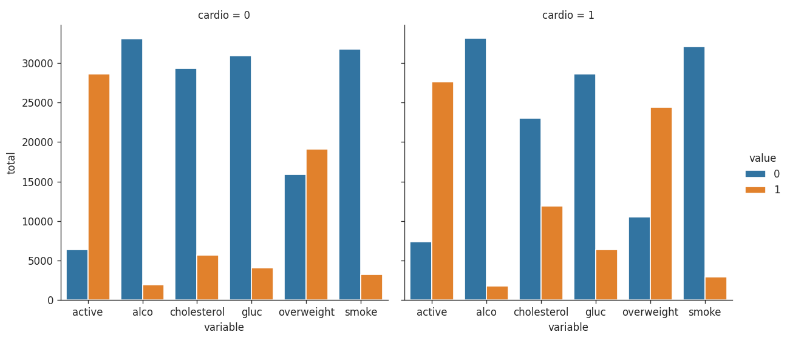
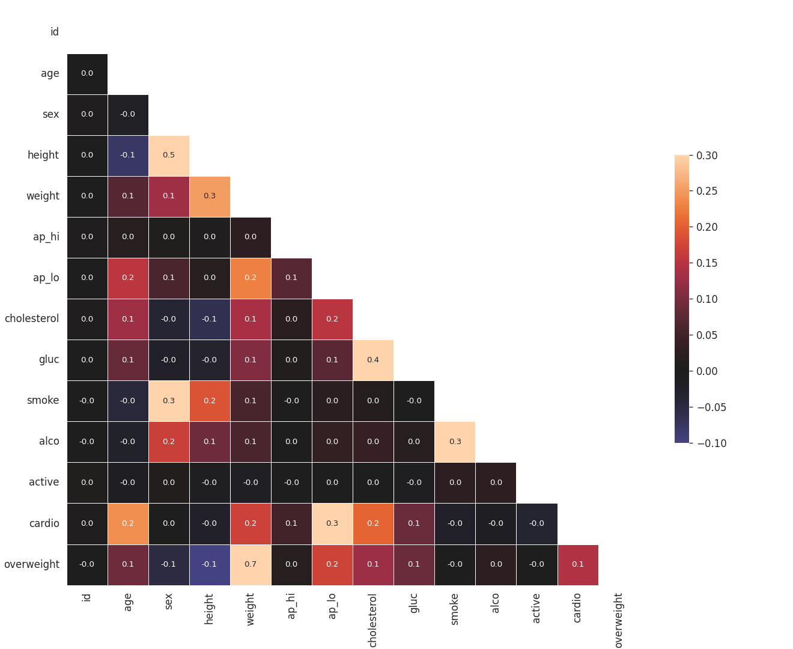

# Medical Data Visualizer

Author: **cear12**

A Pandas, Seaborn and Matplotlib solution to the [freeCodeCamp assignment](https://www.freecodecamp.org/learn/data-analysis-with-python/data-analysis-with-python-projects/medical-data-visualizer), based on the [official starter](https://github.com/freeCodeCamp/boilerplate-medical-data-visualizer).

[`medical_data_visualizer.py`](medical_data_visualizer.py) exposes the required `draw_cat_plot()` and `draw_heat_map()` functions. Each returns a Matplotlib Figure and saves its PNG beside the module. The source CSV is also resolved relative to the module, so loading the project works from another current directory.

## Verified outputs

All **9 tests passed**, including all **4 unchanged original tests**. The original checks verify categorical labels and bar counts, heatmap labels and all 91 lower-triangle correlation annotations. Both saved figures were inspected against the reference images.

### Categorical comparison



The two panels compare six binary attributes for `cardio = 0` and `cardio = 1`. Counts use all **70,000 source records**. The legend identifies values 0 and 1; the plot uses the assignment's variable labels and order.

### Correlation heatmap



The heatmap uses **63,259 records** remaining after the specified filters. It shows Pearson correlations with one-decimal annotations and masks the diagonal and upper triangle. The color range follows the reference figure, while annotations show the computed correlation values.

## Data processing

- Derive `overweight` from `weight / (height / 100) ** 2 > 25`; a BMI exactly equal to 25 is encoded as 0.
- Normalize `cholesterol` and `gluc`: source value 1 becomes 0, and values above 1 become 1.
- Melt the six categorical attributes, then count by `cardio`, variable and binary value.
- For the heatmap, retain rows with `ap_lo <= ap_hi`.
- Retain heights and weights within their respective **inclusive 2.5th–97.5th percentile bounds**, computed from the original prepared frame before filtering.
- Calculate correlations using all numeric columns, including the assignment's required `id`, `sex` and derived `overweight` columns.

Preparation and filtering return copies and preserve their input data. The plotted values describe the supplied dataset.

## Run

Use Python 3.12. From this directory:

```powershell
python -m venv .venv
.venv\Scripts\python.exe -m pip install -r requirements.txt
.venv\Scripts\python.exe main.py
```

On Linux/macOS, use `.venv/bin/python`. `main.py` uses a noninteractive rendering backend, creates both PNG files, runs all tests and returns a failing exit code if a test fails. Figures are closed after the checks.

Run only the official tests:

```powershell
.venv\Scripts\python.exe -m unittest test_module -v
```

Run every test:

```powershell
.venv\Scripts\python.exe -m unittest discover -v
```

The independent checks cover the strict BMI boundary, category normalization, grouped counts, inclusive percentile boundaries, quantiles computed before filtering, independent height/weight filtering, equality of blood-pressure values and preservation of source inputs.

## Dataset

The [official CSV](https://github.com/freeCodeCamp/boilerplate-medical-data-visualizer/blob/main/medical_examination.csv) and original `test_module.py` are included unchanged. Dataset SHA-256: `98cd6a32a969ac66548996943f42aa7af148fa6a305a96f3611ef56812336c03`.
