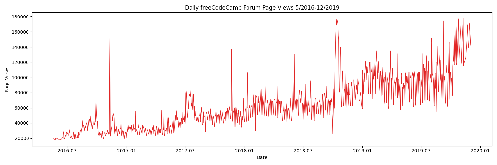
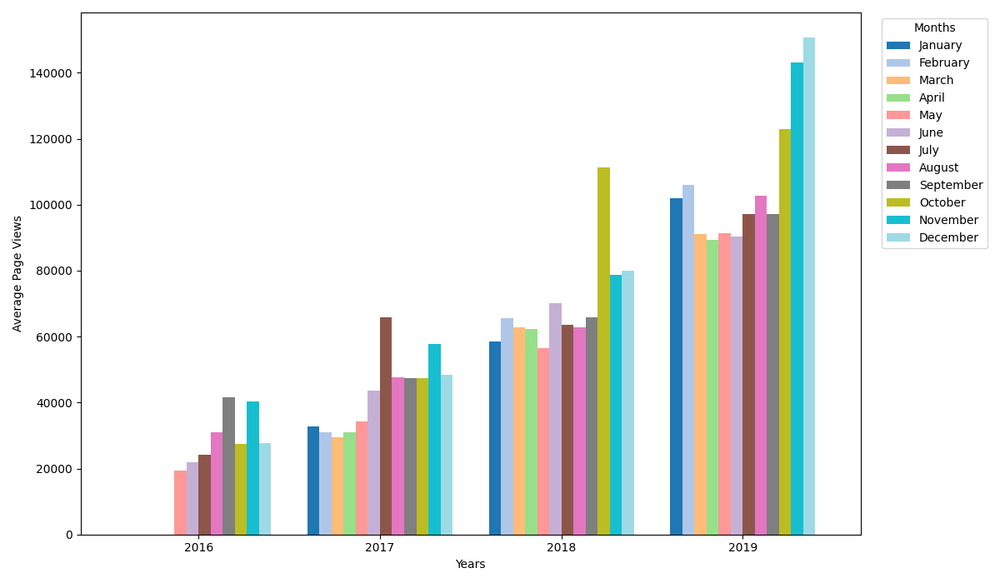
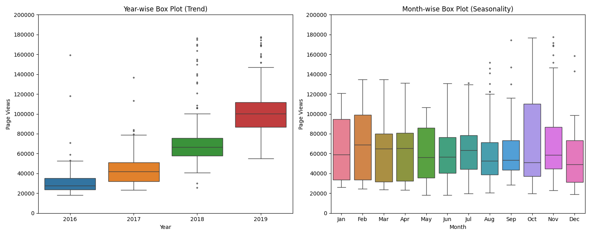

# Page View Time Series Visualizer

Author: **cear12**

A Pandas, Matplotlib and Seaborn solution to the [freeCodeCamp assignment](https://www.freecodecamp.org/learn/data-analysis-with-python/data-analysis-with-python-projects/page-view-time-series-visualizer), based on the [official starter](https://github.com/freeCodeCamp/boilerplate-page-view-time-series-visualizer).

[`time_series_visualizer.py`](time_series_visualizer.py) exposes the required `draw_line_plot()`, `draw_bar_plot()` and `draw_box_plot()` functions. Each returns a Matplotlib Figure and saves the corresponding PNG using the starter's unchanged save/return blocks.

## Verified results

All **15 tests passed**, including all **11 unchanged original tests**. The original checks cover the cleaned row count, titles, axis labels, chronological month labels, line-point count, bars and boxes. All three generated images were visually compared with the official examples.

### Daily page views



The line chart plots every cleaned daily observation, without aggregating or smoothing the series.

### Average daily views by month and year



Each bar is the mean of the cleaned daily observations for its calendar year and month. Month labels run from January to December. Months without observations remain missing in the aggregation and are displayed as empty bar positions.

### Trend and seasonality



The first panel groups observations by year; the second groups them by calendar month across years. Both use the same cleaned data and comparable vertical scales.

## Data processing

- Read the supplied `fcc-forum-pageviews.csv`, parsing `date` as a DatetimeIndex.
- The source contains **1,304 daily records**, from **2016-05-09 through 2019-12-03**.
- Keep values between the original 2.5th and 97.5th percentiles, inclusive: **17,876.4–177,613.075**.
- The cleaned dataset contains **1,238 observations**.
- Compute each monthly mean from that year/month's retained daily records.
- Preserve the cleaned global DataFrame when preparing individual plots.

## Run

Use Python 3.12. From this directory:

```powershell
python -m venv .venv
.venv\Scripts\python.exe -m pip install -r requirements.txt
.venv\Scripts\python.exe main.py
```

On Linux/macOS, use `.venv/bin/python`. `main.py` uses a noninteractive backend, creates all three PNG files in the project directory, runs all tests, closes figures and returns a failing exit code if a test fails.

Run only the official tests:

```powershell
.venv\Scripts\python.exe -m unittest test_module -v
```

Run all checks:

```powershell
.venv\Scripts\python.exe -m unittest discover -v
```

When calling plotting functions directly, their PNGs are saved in the current working directory, matching the starter contract. The input CSV is resolved relative to the module.

Additional checks verify inclusive percentile boundaries, daily means rather than monthly totals, calendar ordering, missing months, preservation of the input data and exact daily values used by the line chart.

## Sources

The [official CSV](https://github.com/freeCodeCamp/boilerplate-page-view-time-series-visualizer/blob/main/fcc-forum-pageviews.csv) and original `test_module.py` are included unchanged. [Reference images](https://github.com/freeCodeCamp/boilerplate-page-view-time-series-visualizer/tree/main/examples) define the requested layouts.

Dataset SHA-256: `45c48a13e841b13df04743c436337a1757fae166c9a9e379c5fd4f3d4c5ddfd0`.
