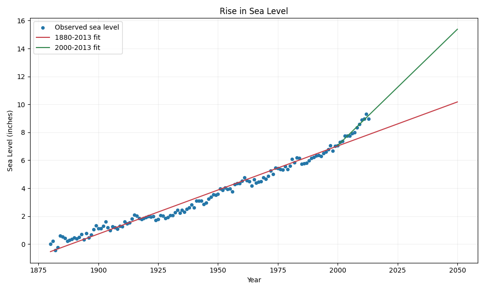

# Sea Level Predictor

Author: **cear12**

A Pandas, SciPy and Matplotlib solution to the [freeCodeCamp assignment](https://www.freecodecamp.org/learn/data-analysis-with-python/data-analysis-with-python-projects/sea-level-predictor), based on the [official starter](https://github.com/freeCodeCamp/boilerplate-sea-level-predictor).

[`draw_plot()`](sea_level_predictor.py) returns a Matplotlib Axes, plots the supplied observations and extends two least-squares regression lines through **2050 inclusive**. The starter's protected save/return block is preserved unchanged.

## Verified result

All **7 tests passed**, including all **4 unchanged original tests**. The original suite verifies titles, labels, ticks, every observed scatter point and all values on both regression lines. The saved plot was also inspected visually.



| Regression fit | Observations | Fitting period | Value extrapolated to 2050 |
| --- | ---: | --- | ---: |
| Full series | 134 | 1880–2013 | 10.18 inches |
| Recent series | 14 | 2000–2013 | 15.38 inches |

These values continue each fitted historical slope on the supplied adjusted sea-level scale. The source data ends in 2013; points after that year are extrapolations of the fitted lines.

## Method

- Read the supplied `epa-sea-level.csv`, resolving its path relative to the module.
- Scatter `Year` against `CSIRO Adjusted Sea Level` for all 134 records.
- Fit `scipy.stats.linregress` on the full series and plot yearly values from 1880 through 2050.
- Independently fit observations with `Year >= 2000` and plot yearly values from 2000 through 2050.
- Use the required title `Rise in Sea Level`, x label `Year` and y label `Sea Level (inches)`.

Fitting uses only the year and CSIRO sea-level columns. Missing values in the separate NOAA column do not remove historical observations. Regression parameters are calculated from the CSV.

## Run

Use Python 3.12. From this directory:

```powershell
python -m venv .venv
.venv\Scripts\python.exe -m pip install -r requirements.txt
.venv\Scripts\python.exe main.py
```

On Linux/macOS, use `.venv/bin/python`. The entry point uses a noninteractive backend, creates `sea_level_plot.png` in the project directory, prints both 2050 values and runs all tests. It closes figures afterward and returns a failing exit code if a test fails.

Run the original tests:

```powershell
.venv\Scripts\python.exe -m unittest test_module -v
```

Run every check:

```powershell
.venv\Scripts\python.exe -m unittest discover -v
```

When calling `draw_plot()` directly, the PNG is saved in the current working directory, matching the starter contract. The independent checks verify regression windows using hand-checkable data, inclusion of the year 2000, correct fitting-column selection, both projection endpoints and separate figures on repeated calls.

## Dataset

The [official CSV](https://github.com/freeCodeCamp/boilerplate-sea-level-predictor/blob/main/epa-sea-level.csv) and original `test_module.py` are included unchanged. Dataset SHA-256: `fcec65cd50d08082246949e544e0b94f6b4f257c2ab76ab41a02fec21aeb5d1a`.
