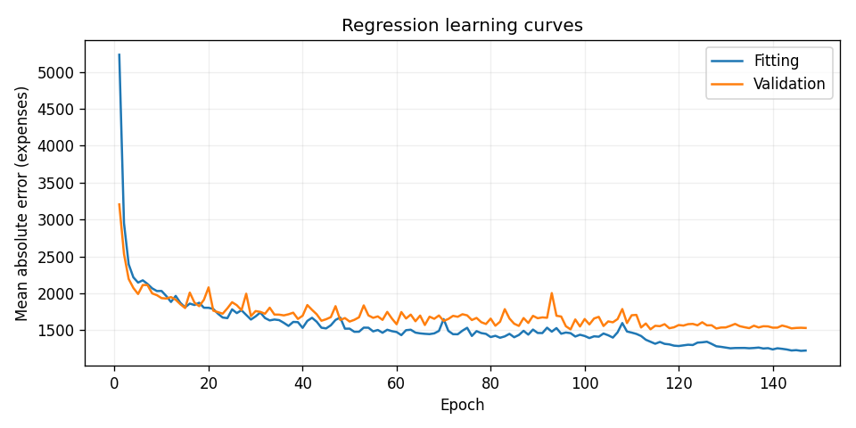

# Linear Regression Health Costs Calculator

Author: **cear12**

[Open in Google Colab](https://colab.research.google.com/github/cear12/learning-projects/blob/main/freecodecamp/machine-learning-with-python-certification/fcc_predict_health_costs_with_regression.ipynb) · [Executed notebook](../fcc_predict_health_costs_with_regression.ipynb) · [Assignment](https://www.freecodecamp.org/learn/machine-learning-with-python/machine-learning-with-python-projects/linear-regression-health-costs-calculator)

Predict insurance expenses from age, sex, BMI, number of children, smoking status and region using TensorFlow/Keras. The notebook downloads the official dataset, encodes categories, separates training and test records, trains a regression network, and runs the original freeCodeCamp evaluation cell unchanged. The required test mean absolute error (MAE) is below **3,500** expense units.

## Verified result

The executed notebook passed the original freeCodeCamp check. All **13 automated tests passed**.

| Metric | Measured result |
| --- | ---: |
| Held-out test MAE | **1,785.45** |
| Required test MAE | Below 3,500 |
| Test RMSE | 5,182.70 |
| Training-median baseline test MAE | 8,454.37 |
| Best validation MAE | 1,512.40 |
| Epochs completed / selected | 147 / 97 |



## Method

- Reproducible 80% / 20% training-pool/test split with seed 42.
- Training pool: 1,070 records, divided into 856 fitting and 214 validation records. The test set contains 268 records.
- Fixed one-hot vocabularies for categorical attributes; 11 numeric input columns. The target is removed from the input features.
- Normalization statistics fitted exclusively to the 856 fitting records.
- Two 64-unit dense layers, followed by a nonnegative output and rescaling to original expense units.
- Adam optimizer and MAE loss; learning-rate reduction and early stopping based exclusively on validation loss.
- Best checkpoint reloaded before the held-out test. The final test metric is also calculated directly from saved predictions.

The regression network captures nonlinear interactions among the input attributes. Test labels remain separate from fitting, normalization, early stopping and checkpoint selection.

## Run

Use Python 3.12. From this directory:

```powershell
python -m venv .venv
.venv\Scripts\python.exe -m pip install -r requirements.txt
.venv\Scripts\python.exe scripts/run_notebook.py
.venv\Scripts\python.exe -m pytest -q
```

On Linux/macOS, use `.venv/bin/python`. In Colab, open the notebook and run all cells. The notebook is self-contained and uses the usual preinstalled data-science libraries. Use the pinned requirements locally to reproduce the checked environment.

The first execution downloads a 50 KB CSV. Cached data is reused after checksum verification. A GPU is optional. Different hardware and library versions may give slightly different training results.

## Files and calculator

- `artifacts/metrics.json`: measured results, split sizes and baseline comparison.
- `artifacts/test_predictions.csv`: all 268 held-out predictions with source row indices and actual expenses.
- `artifacts/training_history.csv`: per-epoch training and validation metrics; epoch indices start at zero.
- `artifacts/feature_schema.json`: ordered columns and categorical vocabularies.
- `artifacts/learning_curves.png` and `artifacts/actual_vs_predicted.png`: diagnostics.
- `artifacts/health_costs.keras`: locally saved model, including normalization. Binary checkpoints and cached data are excluded from Git.

After executing the notebook, call its `predict_expenses(records)` helper with a DataFrame or a list of records containing all six input attributes. It uses the same preprocessing and returns estimates in the original expense units. Invalid categories, missing fields, missing values and invalid numbers are rejected.

The measured error applies to this dataset and split. Individual residuals can be much larger than the average; the output is an educational dataset estimate rather than a personal insurance quote.

## Rebuild

`scripts/build_notebook.py` contains the readable source cells. It reads the unchanged official final test from `.cache/starter.ipynb`. Obtain the starter with:

```python
from pathlib import Path
from urllib.request import urlopen
Path(".cache").mkdir(exist_ok=True)
url = "https://raw.githubusercontent.com/freeCodeCamp/boilerplate-linear-regression-health-costs-calculator/main/fcc_predict_health_costs_with_regression.ipynb"
Path(".cache/starter.ipynb").write_bytes(urlopen(url).read())
```

Run `scripts/build_notebook.py`, then `scripts/run_notebook.py` to recreate the notebook and its outputs.

## Sources

- [Official starter](https://github.com/freeCodeCamp/boilerplate-linear-regression-health-costs-calculator)
- [Official data mirror](https://github.com/freeCodeCamp/cdn/tree/main/build/project-data/health-costs)
- [TensorFlow regression tutorial](https://www.tensorflow.org/tutorials/keras/regression)

Dataset SHA-256: `6f9588de10a0a8a1f2d1356468f2d21e62ab20b141f316d882fc9b4aa3f29938`.
