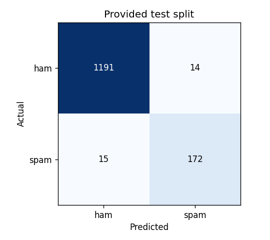

# Neural Network SMS Text Classifier

Author: **cear12**

[Open in Google Colab](https://colab.research.google.com/github/cear12/learning-projects/blob/main/freecodecamp/machine-learning-with-python-certification/fcc_sms_text_classification.ipynb) · [Executed notebook](../fcc_sms_text_classification.ipynb) · [Assignment](https://www.freecodecamp.org/learn/machine-learning-with-python/machine-learning-with-python-projects/neural-network-sms-text-classifier)

The standalone notebook implements `predict_message(text)` using a TensorFlow/Keras neural network. It returns `[spam_score, "ham" or "spam"]`, where the score is a Python float between zero and one. Scores at or above 0.5 map to spam. The original freeCodeCamp final check is preserved unchanged.

## Verified results

All **7 official examples** were classified correctly, and all **23 automated tests passed**.

| Metric | Provided test split | Unique test texts absent from training |
| --- | ---: | ---: |
| Messages | 1,392 | 1,221 |
| Accuracy | **97.92%** | **97.71%** |
| Spam precision | 92.47% | 89.78% |
| Spam recall | 91.98% | 89.78% |
| Spam F1 | 92.23% | 89.78% |

The provided test split contains **152 exact message texts also present in the provided training file**. Its accuracy includes those rows. The additional column excludes all texts present in the training pool and removes duplicate test texts. The always-ham baseline accuracy on the provided split is 86.57%.



## Training

- Original training rows: 4,179. Remove 244 exact duplicate texts before splitting.
- Stratified split of 3,935 unique messages into 3,148 fitting and 787 validation messages, using seed 42.
- Learn word and two-word TF-IDF features exclusively from fitting texts, with at most 10,000 vocabulary entries.
- L2-normalize the text vectors, then use a 32-unit dense hidden layer, dropout and a sigmoid output.
- Balance class weights using fitting labels only. Fit loss is class-weighted; validation loss is unweighted.
- Train with Adam and binary cross-entropy. Select the lowest-validation-loss checkpoint: epoch 16, with 21 epochs completed after early stopping.
- Keep the threshold fixed at 0.5. Test rows and official example labels do not determine vocabulary, weights, early stopping or threshold.

The saved model contains the vocabulary, IDF weights and neural-network weights. Predictions use its learned text features, without a hard-coded message lookup or keyword rules.

## Run

Use Python 3.12. From this directory:

```powershell
python -m venv .venv
.venv\Scripts\python.exe -m pip install -r requirements.txt
.venv\Scripts\python.exe scripts/run_notebook.py
.venv\Scripts\python.exe -X utf8 -m pytest -q
```

On Linux/macOS, use `.venv/bin/python`. In Colab, open the notebook and run all cells; the usual data-science libraries are preinstalled. The notebook does not import project files. The local runner starts a UTF-8 kernel so learned Unicode vocabulary assets can be saved on Windows.

Downloads total less than 0.5 MB. SHA-256 checksums verify the two source files. Data is cached, and a GPU is optional. Library and hardware differences can slightly affect training results.

## Use the classifier

After running the notebook:

```python
predict_message("how are you doing today?")
```

The helper returns a Python list with a model score and label. Non-string and blank inputs raise clear errors. To restore the local checkpoint, use `keras.models.load_model("artifacts/sms_classifier.keras")`, then pass it to `classify_message(text, restored_model)`. Text preprocessing is included in the checkpoint.

## Artifacts and checks

- [`artifacts/metrics.json`](artifacts/metrics.json): provided-split and overlap-excluded metrics, confusion matrices, dataset sizes and hashes.
- [`artifacts/official_checks.json`](artifacts/official_checks.json): expected and predicted labels and model scores for all seven official checks.
- [`artifacts/test_predictions.csv`](artifacts/test_predictions.csv): all provided test scores, labels and overlap flags, indexed by source row. Message bodies are not copied into this report.
- [`artifacts/training_history.csv`](artifacts/training_history.csv): per-epoch metrics, with zero-based epoch indices.
- `artifacts/sms_classifier.keras`: locally saved checkpoint; binary weights and cached data are excluded from Git.

Tests cover TSV parsing, duplicate isolation, stratification, malformed inputs, independent metric counts, the return contract and threshold, fitting-only vocabulary, and serialization of the text model and its Unicode vocabulary.

## Rebuild

`scripts/build_notebook.py` holds the readable source cells and reads the official final check from `.cache/starter.ipynb`. Obtain it with:

```python
from pathlib import Path
from urllib.request import urlopen
Path(".cache").mkdir(exist_ok=True)
url = "https://raw.githubusercontent.com/freeCodeCamp/boilerplate-neural-network-sms-text-classifier/main/fcc_sms_text_classification.ipynb"
Path(".cache/starter.ipynb").write_bytes(urlopen(url).read())
```

Run `scripts/build_notebook.py`, then `scripts/run_notebook.py` to regenerate the executed notebook.

## Sources and scope

- [Official starter](https://github.com/freeCodeCamp/boilerplate-neural-network-sms-text-classifier)
- [Official data mirror](https://github.com/freeCodeCamp/cdn/tree/main/build/project-data/sms)
- [TensorFlow text classification tutorial](https://www.tensorflow.org/tutorials/keras/text_classification)

The score is an uncalibrated sigmoid output. Results describe the supplied English-language SMS data; other languages and unfamiliar spam campaigns can perform differently. Exact text overlap is measured directly and reported separately from the unique texts absent from training.
